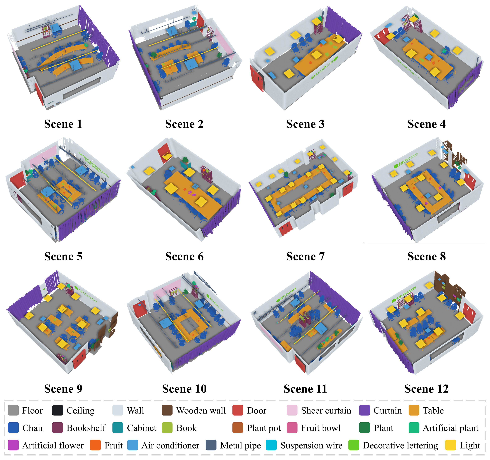
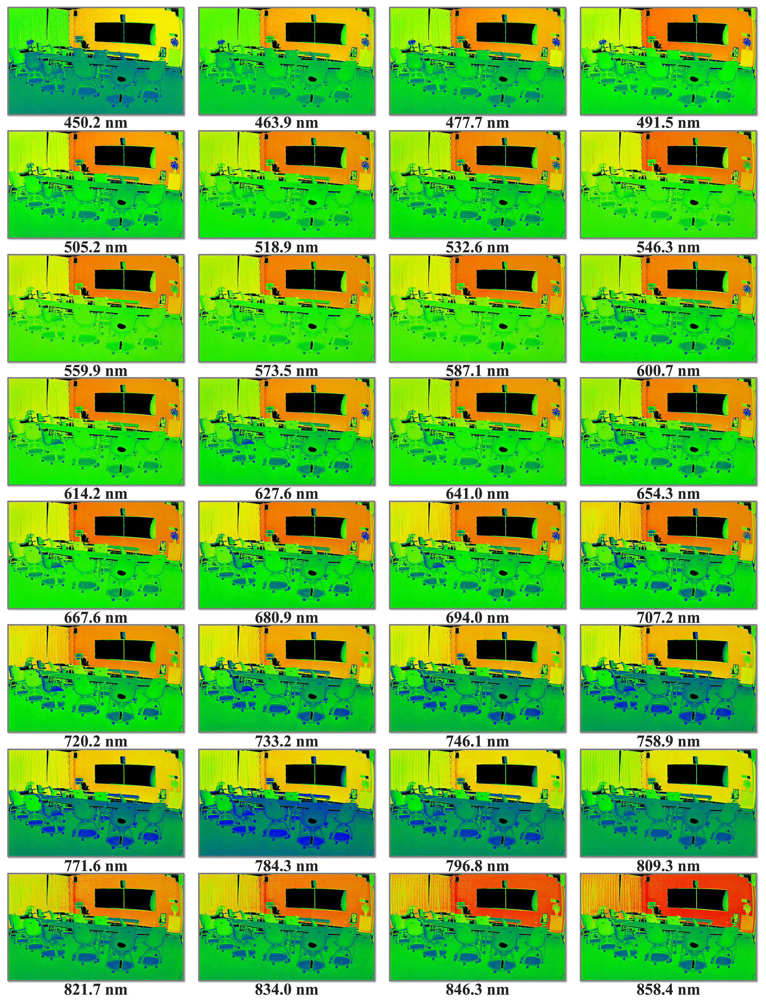
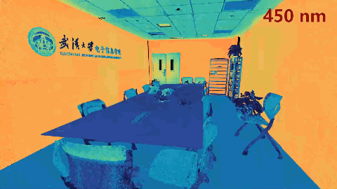
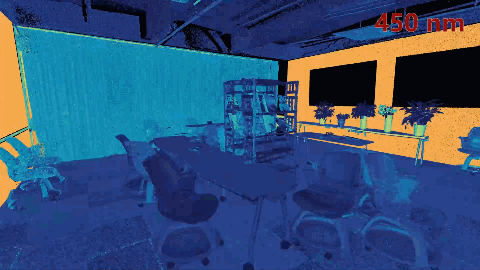

# HSLScene3D

**An Indoor Hyperspectral LiDAR Point Cloud Dataset for 3D Semantic Segmentation**

## Introduction

HSLScene3D is an indoor hyperspectral LiDAR (HSL) point cloud dataset developed for 3D semantic segmentation. The dataset provides jointly acquired 3D spatial and hyperspectral information with point-wise semantic annotations, supporting research on spatial–spectral feature learning and 3D scene understanding.

## Dataset Overview

HSLScene3D comprises 12 indoor scenes with diverse spatial layouts and object compositions. The dataset contains approximately 229 million points annotated into 23 semantic classes. Each point is associated with 3D coordinates, a 32-band reflectance spectrum, and a semantic class label.

| Scenes | Points | Semantic Classes | Spectral Bands |
|:---:|:---:|:---:|:---:|
| 12 | ~229M | 23 | 32 |

### Semantic Annotations

The dataset includes 23 semantic categories covering architectural components, furniture, equipment, plants, and everyday objects.

*Figure 1. Ground-truth semantic annotations of the 12 indoor scenes in HSLScene3D.*

### Spectral Visualization

Each point contains reflectance measurements across 32 spectral bands, capturing wavelength-dependent spectral variations among different objects and materials.

*Figure 2. Reflectance distributions of an indoor HSL point cloud across 32 spectral bands.*

## Scene Visualizations

The following animations showcase two representative indoor scenes from HSLScene3D.

### Scene 4

[View Full Video (MP4)](./Scene4.mp4)

### Scene 11

[View Full Video (MP4)](./Scene11.mp4)
